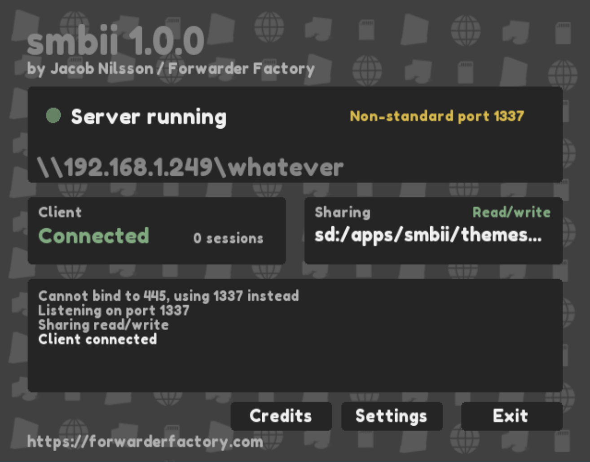
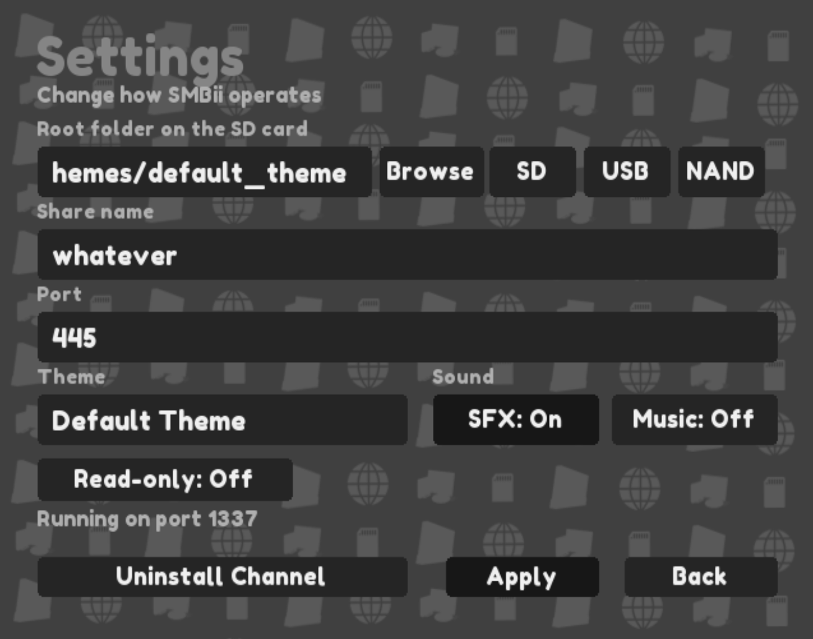

# smbii

SMB server for the Nintendo Wii/vWii, written in C++

This SMB server supports read/write access to the SD card, USB ports and NAND of your Wii, over the network. 

## Usage

1. Download the latest release and place the apps/ folder on your SD card.
    - Please ensure that the themes/ folder is present; SMBii cannot operate without a theme present.
2. Launch it from the Homebrew Channel (v1.0.7 or later recommended)
3. Optional: Configure authentication in the settings. Windows 11 may require this, by default.
4. Connect from the Windows Explorer. Your local IP address and share name should be displayed on your console, 
simply visit \\<your_ip>\<share_name> in Explorer to connect to the Wii. Ensure you're on the same network as the Wii.
You can change the share directory in the settings using your Wiimote.
    - SMB Guest authentication may be required to be enabled in Windows, if authentication is not set up.
5. Optionally, install the channel from the Settings menu for easier access to SMBii.

## Themes

You can download and contribute your themes over at [smbii-themes](https://github.com/jacnils/smbii-themes).

Themes inherit from the default theme, i.e. the theme with __default=on defined.
Third-party themes should not use this, and if no theme uses it the first theme
loaded will be used in its place. At a minimum, a theme should contain a theme.ini file.

The syntax of this file is as follows:

- general properties:
  -   name=My Theme
  -   author=me
  -   description=Whatever this is

- colors; RRGGBB or RRGGBBAA, with or without # prefix.
  -   bg=#000000FF
  -   panel=#000000FF        
  -   border=#000000FF
  -   text=#000000FF        
  -   dim=#000000FF
  -   accent=#000000FF
  -   ok=#000000FF
  -   warn=#000000FF 
  -   primary=#000000FF

- shaping options
  -   radius=int                 corner radius of panels (0 = square, max 32)
  -   button_radius=6            corner radius of buttons, fields and keys (-1 = same as radius)
  -   border_width=1             outline thickness in pixels (0 = no outline, max 4)

- shadows
  -   shadow=on                  enable/disable drop shadow behind panels
  -   shadow_color=#000000       color as before
  -   shadow_x=3                 x offset
  -   shadow_y=4                 y offset
  -   shadow_soft=2              shadow edge softness
  -   button_shadow=off          also put shadows behind buttons

- background
  -   background_mode=stretch    stretch/tile/center/scroll
  -   tile_scale=1.0             size of one tile when tiled
  -   background_blur=0          blur radius applied to the background image (0 = off, max 32)
  -   panel_blur=0               >0: frosted glass
  -   pattern=off                on to enable an animated and tiled pattern
  -   pattern_tile=120           tile size
  -   pattern_padding=16         padding between tiles
  -   pattern_speed=30           moving speed of a pattern
  -   pattern(1-8)_scale=1.0     scale of a given tile

- audio
  -   sfx_volume=100             percentage integer
  -   music_volume=100           percentage integer
  -   music_loop=on              loop music?

- misc
  -   show_attribution=off       set to off if you dont wanna show copyright :(
  -   show_url=off               set to off if you dont wanna promote forwarder factory :(
  -   show_logo=off              set to off if you dont want a logo and too lazy to make it transparent i guess

## Dolphin Emulator note

Windows does not allow you to bind to a port on the default port, 445, which is also the port Windows 
connects to SMB servers with. Because of this, when you run smbii in Dolphin, or if 445 
otherwise cannot be used, port 1337 will be used instead. You can change the port in the settings
to something else if you want to.

Connecting on a non-standard port requires Windows 11 (unfortunately) and also PowerShell:

```ps
New-SmbMapping -LocalPath Z: -RemotePath \\<ip_or_simply_localhost>\wii -TcpPort 1337 -UserName "" -Password ""
```

## Screenshots




## License/Copying

Copyright (c) 2026 Jacob Nilsson / Forwarder Factory

Permission is hereby granted, free of charge, to any person obtaining a copy of this software and associated documentation files (the "Software"), to deal in the Software without restriction, including without limitation the rights to use, copy, modify, merge, publish, distribute, sublicense, and/or sell copies of the Software, and to permit persons to whom the Software is furnished to do so, subject to the following conditions:

The above copyright notice and this permission notice shall be included in all copies or substantial portions of the Software.

THE SOFTWARE IS PROVIDED "AS IS", WITHOUT WARRANTY OF ANY KIND, EXPRESS OR IMPLIED, INCLUDING BUT NOT LIMITED TO THE WARRANTIES OF MERCHANTABILITY, FITNESS FOR A PARTICULAR PURPOSE AND NONINFRINGEMENT. IN NO EVENT SHALL THE AUTHORS OR COPYRIGHT HOLDERS BE LIABLE FOR ANY CLAIM, DAMAGES OR OTHER LIABILITY, WHETHER IN AN ACTION OF CONTRACT, TORT OR OTHERWISE, ARISING FROM, OUT OF OR IN CONNECTION WITH THE SOFTWARE OR THE USE OR OTHER DEALINGS IN THE SOFTWARE.
